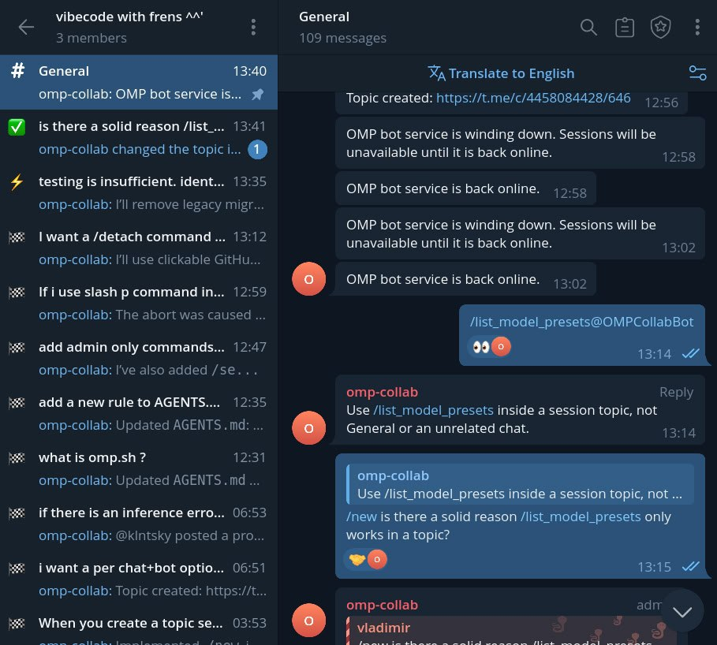

# OMP Telegram Collab

Run [OMP](https://github.com/can1357/oh-my-pi) coding sessions from Telegram forum topics on your own machine. Telegram, the optional Mini App, and the local OMP terminal connect to the same session.



- Give each topic its own conversation and saved history.
- Send prompts and answer agent questions in Telegram. Open the read-only Mini App at the latest messages, load earlier history on demand, and follow live output and tool details.
- Attach existing local OMP sessions.
- Share project directories across groups with configurable prompt approval.
- Edit the included Collab Web client without an iframe.

## OMP feature coverage

✅ Available in Telegram · 📱 Mini-app only · ❌ No remote equivalent.

| Support level | OMP feature | Use from Telegram |
| --- | --- | --- |
| ✅ | Create a session (`/new`) | `/new <task>` creates a topic and starts its session. Configured runtime folders offer a directory picker first. |
| 📱 | Inspect session information (`/session`) | Telegram `/session` opens the Mini App for the topic's session. |
| ✅ | Join a shared session in a terminal (`omp join`) | `/cli` gives administrators a copyable command to join the topic's host from the bot's machine. |
| ✅ | Resume saved session history (`/resume`) | Send a prompt in an existing managed topic to resume its history. |
| ✅ | Rename a session (`/rename`) | Rename the Telegram topic to update its managed OMP session title. Attached hosts must be renamed in their terminal. |
| ❌ | Move a session or manage workspace directories (`/move`, `/add-dir`, `/remove-dir`, `/dirs`) | No dedicated workspace controls. |
| ✅ | Fork a conversation (`/fork`) | `/fork` creates a separate topic. Reply to a request or agent answer to select the fork point. The new topic follows the forum's automatic-worktree setting. |
| ❌ | Branch, rewind, or switch history branches (`/branch`, `/rewind`, `/tree`) | No in-place history mutation controls. |
| ❌ | Reset context, delete a session, refresh provider state, or retry a failed turn (`/clear`, `/delete`, `/fresh`, `/retry`) | No equivalent controls. |
| ✅ | Move a session into a worktree (`/wt`, `/worktree`) | `/worktree [branch]` invokes OMP's native operation, keeping the topic's conversation and carrying changes according to OMP's settings. In General, it creates a topic first. |
| ✅ | Share a running session through Collab (`/collab`, `omp collab`) | `/attach INSTANCE_ID` creates a topic connected to an existing local host. |
| 📱 | Leave or join a shared Collab session (`/leave`, `/join`) | Open `/session`, then use Leave or Rejoin for that topic's connection. This does not terminate the host. |
| ❌ | Create arbitrary Collab share links or join arbitrary rooms (`/collab`, `/join`, `omp collab`, `omp join`) | No remote link-creation or arbitrary-room interface. |
| ✅ | Submit text prompts | `/p <prompt>` or ordinary Telegram messages when enabled. |
| ✅ | Submit image prompts | Send photos or supported image documents in Telegram, with `/p` when required by prompt policy. |
| ✅ | Answer agent questions | Use Telegram option buttons, Other, or Cancel. |
| ✅ | Interrupt the current turn | `/stop`. This does not freeze all agents. |
| ✅ | Force-kill a session host | `/kill` preserves managed history; a later prompt can resume it. |
| ❌ | Orderly exit or same-flags restart (`/exit`, `/quit`, `/q`, `/restart`) | `/kill` is forceful termination, not these lifecycle operations. |
| ✅ | Read agent replies | Replies are mirrored into the topic and streamed in the Mini App. |
| 📱 | Inspect the full live transcript and tool calls | Open `/session` to inspect tool arguments, results, partial output, and expandable tool details. |
| 📱 | Inspect thinking and message metadata | Expand disclosures in the Mini App transcript. |
| 📱 | Inspect subagent roster and activity (`/hub`, `/subagents`) | Open the Mini App agent rail to see status, current tool or intent, and last activity. |
| 📱 | Read a subagent's transcript (`/hub`, `/subagents`) | Select an agent to open its drawer. Transcript access requires an available session file. Viewers can read it too. |
| ❌ | Chat with a subagent (`/hub`, `/subagents`) | Ask the main agent through Telegram to direct its subagents. |
| ❌ | Kill a running subagent (`/hub`, `/subagents`) | No direct subagent controls. Ask the main agent through Telegram. |
| ❌ | Revive a parked or aborted subagent (`/hub`, `/subagents`) | No direct subagent controls. Ask the main agent through Telegram. |
| 📱 | Inspect subagent model and usage (`/hub`, `/subagents`) | The agent rail and drawer show model, tokens, cost, tool count, and duration when the host supplies them. |
| ❌ | Configure per-agent models, prewalk, or advisor (`/agents`) | No corresponding Mini App or bot controls. |
| ✅ | List, save, switch, and delete model presets (`/modelpreset`) | `/model_preset` browses preset models and roles with buttons to use one in the idle topic or make it the forum default. `/model_preset <name>` switches directly; `/settings` also selects the forum default. To edit presets, ask the agent. |
| 📱 | Inspect the current model and reasoning level | Read the Mini App header and model/thinking-change markers in the transcript. |
| ❌ | Select model and reasoning level independently (`/model`, `/models`, `/switch`, `/effort`) | No independent selectors. `/model_preset` applies predefined combinations instead. |
| 📱 | Inspect context-use percentage (`/context`) | Read the Mini App header's context gauge. |
| ❌ | Browse detailed context contents (`/context`) | No context inspector. The transcript is not a view of the complete model context. |
| 📱 | View compaction and branch-summary markers | The Mini App transcript displays summaries and changes already made by the host. |
| ❌ | Manually compact or reduce context (`/compact`, `/shake`, `/handoff`) | No controls to initiate these operations. |
| ❌ | Inspect the prompt queue count | No dedicated queue display. |
| ❌ | Explicitly queue prompts and edit or remove pending messages (`/queue`, terminal queue controls) | No queue-management controls. Ordinary prompt delivery still follows the host's queue behavior. |
| 📱 | Read todo and background-job tool output | Inspect tool cards in the Mini App transcript. These are emitted results, not the live `/todo` or `/jobs` inspectors. |
| ❌ | Inspect or edit the live todo list (`/todo`) | No dedicated todo inspector or editor. |
| ❌ | Inspect live background jobs or agent-visible tools (`/jobs`, `/tools`) | No dedicated job inspector or tool-catalog viewer. |
| ❌ | Service tiers, extended context, and one-shot model handoff (`/fast`, `/slow`, `/extended-context`, `/prewalk`) | No dedicated controls. |
| ❌ | Planning and goal modes (`/plan`, `/plan-review`, `/vibe`, `/goal`, `/guided-goal`, `/loop`) | No dedicated mode controls. |
| ❌ | Advisor, security scans, and optimization (`/advisor`, `/security`, `/ratchet`) | No dedicated controls. |
| ❌ | Freeze all agents, force tools, or reset approvals (`/pause`, `/force`, `/force:`, `/forget-approvals`) | No equivalent controls. `/stop` only interrupts the current turn. |
| ❌ | Side tasks, maintenance, and debugging (`/btw`, `/tan`, `/seance`, `/omfg`, `/cleanse`, `/debug`, `/memory`) | No dedicated interfaces. |
| ✅ | Select loaded skills for a prompt (`/skill:<name>`) | `/skills` opens the picker; `/skills clear` clears the selection. |
| ❌ | Search, install, or update registry skills (`/skills`, `omp skill`) | The Telegram `/skills` picker selects loaded skills, not registry management operations. |
| ❌ | Toggle the system-prompt skill listing (`/skillful`) | No toggle. |
| ❌ | Run other built-in, file, template, or extension commands (including `/init`) | No OMP command browser or general slash-command dispatch. |
| ❌ | Configure OMP or provider authentication (`/settings`, `/setup`, `/providers`, `/login`, `/logout`) | Telegram `/settings` manages forum policy and defaults, not OMP settings or credentials. `/setup` enrolls a forum. |
| ❌ | Manage extensions or MCP (`/extensions`, `/status`, `/marketplace`, `/plugins`, `/plugin`, `/reload-plugins`, `/mcp`) | Telegram `/status` reports service diagnostics, not OMP's extension dashboard. |
| ✅ | Inspect provider quotas (`/usage`) | `/usage` reports provider plan usage, remaining quotas, and reset times. Displayed subagent costs are separate. |
| ❌ | Open usage dashboards (`/stats`, `/trace`) | No stats or trace dashboards. |
| ✅ | Copy displayed reply text or follow a link | Use Telegram's or the browser's ordinary selection and link actions. |
| ❌ | Use OMP's copy picker or open-last-link command (`/copy`, `/open`) | No equivalent command controls. |
| ❌ | Export, dump requests, or share saved sessions (`/export`, `/dump`, `/share`) | No HTML export, request dump, or encrypted saved-session sharing. |
| 📱 | Change interface themes (`/settings`) | Cycle the Mini App's system, light, and dark appearance in its header. This is independent of OMP's terminal theme. |
| ❌ | Git, editor, and SSH interfaces (`/git`, `/local`, `/ssh`) | No remote Git UI, local editor, or SSH-host manager. |
| ❌ | Browser and desktop modes (`/browser`, `/computer`) | No host browser or desktop-mode toggles. |
| ❌ | Voice and recording (`/live`, `/record`) | No realtime voice or terminal-recording controls. |
| ❌ | Changelog and shortcuts (`/changelog`, `/hotkeys`) | No corresponding OMP viewers. |
| ❌ | List or clear worktrees (`omp worktree`) | No CLI list or clear interface. |
| ❌ | Browse the complete model catalog or manage agent definitions (`omp models`, `omp agents`) | Telegram preset listing and Mini App live-subagent views do not expose these CLI interfaces. |
| ❌ | CLI protocols, credentials, and onboarding (`omp acp`, `omp auth`, `omp auth-broker`, `omp auth-gateway`, `omp login`, `omp token`, `omp setup`) | Run locally. Telegram `/setup` is unrelated to OMP onboarding. |
| ❌ | CLI configuration and installation (`omp config`, `omp install`, `omp plugin`, `omp ssh`, `omp tiny-models`, `omp update`, `omp completions`) | Run locally. |
| ❌ | CLI session transfer, storage, and processes (`omp session`, `omp share`, `omp anonymize`, `omp gc`, `omp ps`, `omp shell`) | No equivalent transfer, sharing, storage, process-manager, or shell interfaces. |
| ❌ | CLI coding workflows (`omp git`, `omp commit`, `omp cleanse`, `omp find`, `omp compress`) | No dedicated CLI interfaces. |
| ❌ | CLI inspection and diagnostics (`omp read`, `omp grep`, `omp search`, `omp toks`, `omp ttsr`, `omp images`, `omp grievances`) | Run locally. |
| ❌ | CLI benchmarks and previews (`omp bench`, `omp if-bench`, `omp dry-balance`, `omp gallery`, `omp predict`, `omp render`) | Run locally. |
| ❌ | CLI relay, media, and usage (`omp browser-relay`, `omp clip`, `omp play`, `omp say`, `omp stream`, `omp stats`, `omp usage`) | No relay-management, recording, broadcast, speech, or usage-dashboard interfaces. |

## Setup

Connect a Telegram group to a project on your computer. The agent runs on that computer while you send tasks and read replies in Telegram. This guide calls it the **agent's computer** to distinguish it from your Telegram device.

You can use the bot entirely through group messages. The optional **Mini App** lets you read a live transcript, inspect tool calls, and view subagent activity inside Telegram. It is read-only for all users. It needs a public HTTPS address and an extra registration with BotFather.

1. **Agent's computer:** Install the latest Node.js LTS with [nvm](https://github.com/nvm-sh/nvm), pnpm, and [OMP](https://github.com/can1357/oh-my-pi). The minimum supported runtime is Node.js 26.13.0. Older versions are unsupported. Configure OMP's model provider credentials for the account that will run the bot, following the [official provider setup guide](https://omp.sh/docs/providers#get-one-route-working).

   <details>
   <summary>Install and select Node.js LTS</summary>

   Example after installing nvm. nvm's download progress is omitted.

   ```text
   $ nvm install --lts
   Installing latest LTS version.
   ...
   $ nvm use --lts
   Now using node v26.13.0 (npm v11.20.0)
   $ node --version
   v26.13.0
   ```

   </details>

2. **Telegram:** Open [BotFather](https://t.me/BotFather) and send `/newbot`. Enter a display name and an available username ending in `bot`. Save the API token privately; you will enter it on the agent's computer.
3. **Agent's computer:** Install the package globally. **The package has not yet been published to npm; this registry install requires a published release before it will work.**

   ```sh
   pnpm add --global omp-telegram-collab
   ```

   If pnpm reports that its global executable directory is not configured, run `pnpm setup`, open a new terminal, and repeat the installation command.

   Use `omp-telegram-collab --help` to list commands. Every command and nested subcommand accepts `--help` or `-h`, such as `omp-telegram-collab setup --help` and `omp-telegram-collab bot add --help`. Help does not require configuration or a running service.

   <details>
   <summary>Example command help</summary>

   Excerpt showing token input options; Mini App and global options are omitted.

   ```text
   $ omp-telegram-collab bot add --help
   Usage: omp-telegram-collab bot add [options]

   Verify and register a Telegram bot

   Options:
     --token-env <variable>        Read the token from an environment variable
     --token-stdin                 Read the token from standard input
   ```

   </details>

4. **Agent's computer:** Configure the service, register the bot with its BotFather token, and start it.

   ```sh
   omp-telegram-collab setup
   omp-telegram-collab bot add
   omp-telegram-collab start
   ```

   For the Mini App, use the public HTTPS origin of your proxy or tunnel, such as `https://omp.example.com`. The Mini App short name must match the name you register with BotFather. Keep `omp-telegram-collab start` running in this terminal.

   <details>
   <summary>Example CLI commands and output</summary>

   Examples use filler values and omit unrelated prompts.

   ```text
   $ omp-telegram-collab setup
   The optional Mini App provides a live transcript, tool details, and subagent activity. It is read-only. It requires a public HTTPS origin and a BotFather Mini App for each bot. Telegram-only mode needs neither.
   Enable Mini App? [y/N]: n
   Service configuration saved to /home/operator/.config/omp-telegram/config.yaml.
   Next on the agent's computer: run omp-telegram-collab bot add, then omp-telegram-collab start. Leave it running. In Telegram, add the bot to your forum and send /setup.

   $ omp-telegram-collab bot add
   Bot token (hidden):
   Added @example_omp_bot (123456789).
   ```

   Mini App example, with other prompts and output omitted:

   ```text
   $ omp-telegram-collab setup
   Enable Mini App? [y/N]: y
   Public HTTPS origin []: https://omp.example.com
   Listen host [127.0.0.1]:
   Listen port [3000]:

   $ omp-telegram-collab bot add
   Bot token (hidden):
   BotFather Mini App short name [app]:
   Added @example_omp_bot (123456789), Mini App app.
   ```

   </details>

5. **Agent's computer, Mini App only:** Expose the configured service over HTTPS using a tunnel or reverse proxy.

   <details>
   <summary>Option 1: Use cloudflared</summary>

   You need a Cloudflare account and at least one domain added to that account with DNS managed by Cloudflare. This example uses `omp.example.com`. Replace `example.com` with your domain.

   1. In the [Cloudflare dashboard](https://dash.cloudflare.com/), open **Networking > Tunnels** and select **Create Tunnel**.
   2. Name the tunnel `omp-telegram`.
   3. Select your operating system and architecture. Follow the displayed commands to install `cloudflared` and run it as a service on the machine running the bot. On Linux, the service installation command looks like this:

      ```sh
      sudo cloudflared service install <TUNNEL_TOKEN>
      ```

      Keep the tunnel token private. The service starts the tunnel automatically after reboot.

   4. Once the tunnel connects, select **Continue**.
   5. Under the tunnel's **Routes**, select **Add route > Published application**.
   6. Set the subdomain to `omp` and select your domain.
   7. Set the service URL to `http://127.0.0.1:3000`, matching the bot's default listen address. If you configured another host or port, use that address.
   8. Save the route. Cloudflare serves `https://omp.example.com` over HTTPS and forwards HTTP and WebSocket traffic to the bot.

   The hostname stays the same across bot and tunnel restarts. Keep the bot and the `cloudflared` service running to make the Mini App available.

   See [Cloudflare's tunnel setup guide](https://developers.cloudflare.com/tunnel/get-started/) for platform-specific installation commands.

   </details>

   <details>
   <summary>Option 2: Set up HTTPS manually</summary>

   1. Point your hostname, such as `omp.example.com`, at the server running your reverse proxy.
   2. Configure the proxy to serve that hostname over HTTPS with a publicly trusted certificate.
   3. Forward requests to the bot's configured listen address, which defaults to `http://127.0.0.1:3000`. Use an address reachable from the proxy if it runs on another machine.
   4. Enable WebSocket forwarding for `/api/socket`, preserving the request path and query string.
   5. Open the per-bot URL printed at startup in your phone's browser using mobile data. Confirm that the page loads over HTTPS with a valid certificate.

   </details>

6. **Telegram, Mini App only:** Send `/newapp` in BotFather to register the Mini App.

   1. Select the bot you created, or send its `@username`.
   2. Enter an app title, such as `OMP Telegram Collab`.
   3. Enter a description, such as `Run coding sessions from Telegram`.
   4. Download the [prepared app photo](assets/botfather-mini-app.png) and upload it when BotFather asks for a photo. It is already 640 × 360 pixels.
   5. Send `/empty` to skip the optional GIF.
   6. For the web URL, paste the complete HTTPS URL printed by `omp-telegram-collab start`, including `?bot=...`. It looks like `https://omp.example.com/?bot=123456789`.
   7. For the short name, enter `app`, or the bot's existing configured short name if you previously registered another name.
   8. BotFather returns the Telegram launch link, such as `https://t.me/your_bot/app`.

7. **Telegram:** Add the bot to a supergroup with Topics enabled. Promote it to administrator with Manage Topics and Pin Messages permissions. Keep BotFather's default privacy setting; administrator bots receive ordinary group messages.
8. **Telegram:** As a group administrator, send `/setup`. Copy the approval command it returns.
9. **Agent's computer, second terminal:** Leave `omp-telegram-collab start` running in the first terminal. Paste the approval command into a second terminal on the same computer. Change `--path` to the existing project directory where OMP should run.

   `--config` appears only for a non-default configuration file. The initial `--path` is the bot process's working directory. Requests expire after ten minutes.

   Check the resolved project directory before confirming. The agent gets the service account's filesystem and credential access, not an isolated view of that directory. Approval registers an existing directory; it does not create one.

   <details>
   <summary>Example Telegram setup messages</summary>

   All names, IDs, paths, and request codes below are filler values. This example assumes the bot runs in `/srv/projects/backend`.


   If Topics or bot permissions are missing:

   ```text
   Use a supergroup with Topics enabled, then grant this bot Manage Topics and Pin Messages permissions.
   ```

   After a group administrator sends `/setup` in an unassigned forum:

   ```text
   Setup requested. On the agent's computer, approve within 10 minutes:
   omp-telegram-collab approve r_EXAMPLE_CODE --path '/srv/projects/backend'
   The project directory defaults to the bot's working directory. Change --path to the project directory where OMP should run. Leave the bot running and use a second terminal.
   ```

   After approval:

   ```text
   Setup approved. This forum is connected to OMP. Use /settings to choose prompt permissions and the session limit. Send /new <task> to start a coding session.
   ```

   </details>

   <details>
   <summary>Example approval command and output</summary>

   Paths and identifiers below are filler values.

   ```text
   $ omp-telegram-collab approve r_EXAMPLE_CODE --path '/srv/projects/backend'
   Verified bot @example_omp_bot (123456789)
   Verified forum Example project (-1001234567890)
   Verified requester 42, current group administrator.
   Project directory where OMP will run: /srv/projects/backend
   The agent will have the service account's filesystem and credential access on the agent's computer.
   Connect this forum to /srv/projects/backend? [y/N] yes
   Approved r_EXAMPLE_CODE: /srv/projects/backend
   ```

   New forums treat ordinary messages as prompts and do not allow non-admin prompt proposals. Change these policies through `/settings`.

   </details>

10. **Telegram:** Review `/settings` for prompt permissions, the session limit, runtime folders, and forum defaults. Send `/new <task>` and confirm that the agent replies in the new topic.

   If you enabled the Mini App, use mobile data to open the topic's **OPEN AGENT** button and confirm that its transcript loads. Keep it open while sending another prompt from a second Telegram client; confirm that the new reply appears live. This checks WebSocket forwarding.

## Configure instances

`instances` is a list of logical projects. Each instance has a stable numeric ID and a default directory for new sessions. Multiple instances can share a directory.

```yaml
instances:
  - id: 1
    defaultDir: /srv/projects/backend
    chats:
      - botId: 123456789
        chatId: -1001234567890
  - id: 2
    defaultDir: /srv/projects/backend
    chats: []
```

This is a configuration excerpt with filler paths and Telegram IDs. Keep the other service settings generated by `setup`.

IDs must be unique positive safe integers. Creation commands choose 1 initially, then an ID above every configured or stored session's instance ID. Use `create PATH --id ID` to choose one explicitly. Keep IDs unchanged when sorting the list or editing directories.

<details>
<summary>Example instances sharing a directory</summary>

Example with a new configuration and an existing filler directory. Other service setup is omitted.

```text
$ omp-telegram-collab create /srv/projects/backend
Created instance 1: /srv/projects/backend
$ omp-telegram-collab create /srv/projects/backend
Created instance 2: /srv/projects/backend
```

</details>

Change `defaultDir` to use another existing canonical absolute directory for future sessions. Existing sessions keep their own working directories, history, and host bindings after reload or restart. Relative `folder_options` use the new default only for new sessions. Moving or deleting an old session's directory can make that session unavailable, but does not prevent the service from starting.

Select an existing instance during enrollment with `approve REQUEST_CODE --instance ID`. Use `--path PATH` to register a new instance. Instance-management commands use IDs so instances sharing a directory remain distinguishable. A forum with stored sessions cannot be reassigned to another instance ID.

The old directory-keyed configuration and older database schemas are not supported. Back up existing configuration and runtime data before replacing them; the service does not convert them automatically.

## Choose a session folder

Open `/settings` as a group administrator and select **Runtime folders**. Choose **Add folder**, then reply to that exact message with a relative path on the agent's computer. Adding appends without replacing existing options. To replace all options, explicitly choose **Replace folders** and reply with relative paths, one per line. Use **Remove** to delete any option, including `.`, or **Clear folders** to empty the list. Missing folders are allowed in the list. Equivalent relative paths are normalized and deduplicated in order.

The folder page summarizes the effective behavior: **Uses `<Default>`**, **Uses projects/backend**, or **Ask when starting a session**. Both **Add folder** and **Replace folders** offer **Cancel**, which returns to the list without saving the pending entry.

<details>
<summary>Example folder settings and selection</summary>

Paths and task names below are filler values. These are label excerpts; other settings controls and prompts are omitted.

1. In **Runtime folders**, choose **Add folder** and reply to the same message:

   ```text
   .
   ```

2. Choose **Add folder** again and reply with `projects/new-service`. The `.` option remains configured.
3. After `/new Inspect the example project`, the bot offers **`<Default>`** for `.` and `projects/new-service` as buttons. No default option is added implicitly.
4. Selecting the missing `projects/new-service` offers **Create folder** and **Cancel** when the service account has permission to create it. Creation requires that separate confirmation.
5. If folder access fails, the task stays pending. **Retry** retries the choice; **Choose another folder** returns to the available options when there is more than one.
6. Choose **Remove `<Default>`** to leave only `projects/new-service`: future sessions use that folder without a picker.

For a member's proposed task with multiple options, an administrator selects a folder in the combined approval-and-selection screen. Selecting an existing folder both approves the task and chooses its directory; there is no separate **Approve** step first. With zero or one stored option, normal administrator approval is still required, then the sole effective folder is used automatically.

</details>

The only folder setting is `folder_options`, defaulting to `[]`. An empty list behaves as `["."]`. Exactly one effective folder is used automatically with no chooser; adding a second distinct entry enables the picker. `["projects/backend"]` uses that folder directly, while `[".", "projects/backend"]` offers **`<Default>`** and `projects/backend`. Removing the final `.` leaves an empty stored list, which again uses the effective default.

`/new` from any topic and `/p` in General follow this cardinality rule. `/p` in an existing session keeps its directory. The chosen folder survives restarts. Worktree preparation starts there and then uses OMP's resulting worktree directory.

All folder entries resolve relative to the forum instance's `defaultDir`, never the bot process's working directory. `.` means that default directory; `..` and paths such as `../sibling` are explicitly allowed. Operating-system user permissions are the security boundary, not containment within the project directory. The bot checks that the resolved path is an accessible directory. Missing folders require explicit creation confirmation, even when there is only one effective folder; that folder is validated before creating a topic or preparing a worktree. Permission failures retain the original operating-system diagnostic and never fall back to another folder. Folder access uses the bot service account, not your Telegram device.

Failed choices retain the task for **Retry**, and offer **Choose another folder** only when multiple effective options exist. Expired requests and pending requests discarded by a service restart explain why the old controls no longer work; they never replay the task. After an expiry or restart-discard notice, send the task again. While selection remains active, use its controls instead of submitting a duplicate task.

Manual Telegram topics use the sole effective folder without a chooser. If it is missing, an administrator must explicitly consent to creation before the session is registered or started; continuation stays in the same Telegram topic. With multiple effective folders, manual topics remain unregistered and direct users to `/new <task>`. Attached hosts keep their terminal-owned directory.
