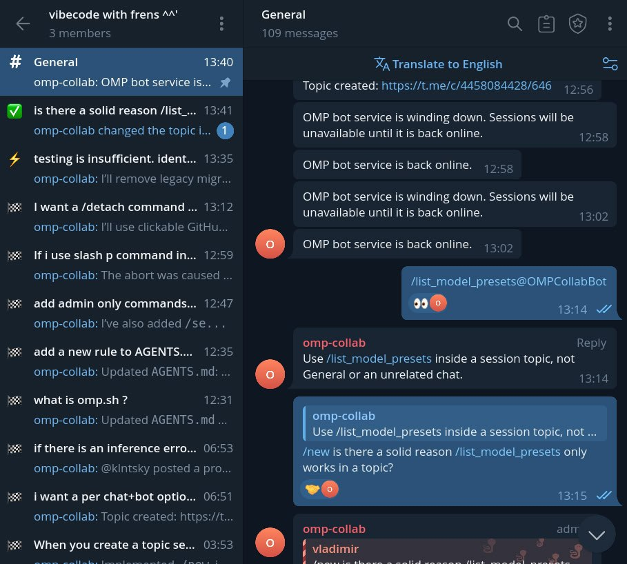

# OMP Telegram Collab

Run [OMP](https://github.com/can1357/oh-my-pi) coding sessions from Telegram forum topics on your own machine. Telegram, the Mini App, and the local OMP terminal connect to the same session.

- Give each topic its own conversation and saved history.
- Send prompts and answer agent questions in Telegram or the Mini App.
- Attach existing local OMP sessions.
- Share project directories across groups with configurable prompt approval.
- Edit the included Collab Web client without an iframe.

## OMP feature coverage

✅ Supported · ⚠️ Partial support · ❌ No remote equivalent. Coverage means an action is available through Telegram or its Mini App, not merely that the agent can be asked to do it.

Compared with [OMP 18.14.0](https://github.com/can1357/oh-my-pi/tree/v18.14.0/packages/coding-agent/src/slash-commands), including built-in slash commands, aliases, and top-level CLI commands. Project and plugin commands vary by installation.

| Support level | OMP feature | Use from Telegram |
| --- | --- | --- |
| ✅ | New sessions (`/new`) | `/new <task>` creates a topic and starts its session. |
| ⚠️ | Session management (`/session`) | `/session` opens the topic's Mini App, not OMP's session-management commands. |
| ⚠️ | Resume and pin sessions (`/resume`, `/pin`) | Return to an existing topic to resume its managed history. No saved-session picker or pin control. |
| ❌ | Session titles and workspaces (`/rename`, `/move`, `/add-dir`, `/remove-dir`, `/dirs`) | No OMP session-title or workspace controls. |
| ❌ | Branching and history navigation (`/branch`, `/rewind`, `/fork`, `/tree`) | No branch or rewind controls. |
| ❌ | Reset, delete, and retry (`/clear`, `/delete`, `/fresh`, `/retry`) | No equivalent actions. |
| ❌ | Manual context management (`/compact`, `/shake`, `/handoff`) | Automatic compaction is visible in the Mini App; manual controls are absent. |
| ⚠️ | Worktree sessions (`/wt`, `/worktree`) | `/worktree [task]` creates a separate session from repository HEAD. It does not move the current session or carry uncommitted changes. |
| ⚠️ | Live collaboration (`/collab`, `/join`, `/leave`) | `/attach INSTANCE_ID` connects a local host; `/session` opens the Mini App with Leave and Rejoin controls. No arbitrary room joining or share-link creation. |
| ❌ | Export and saved-session sharing (`/export`, `/dump`, `/share`) | No HTML export, request dump, or encrypted sharing controls. |
| ⚠️ | Copy text and open links (`/copy`, `/open`) | Use ordinary browser selection and links. No OMP conversation picker or last-link action. |
| ⚠️ | Exit and restart (`/exit`, `/quit`, `/q`, `/restart`) | `/kill` terminates a topic's host; a later prompt can resume a managed session. No orderly exit or same-flags restart control. |
| ⚠️ | Model presets (`/modelpreset`) | `/model_preset <name>` switches an idle managed session or sets the forum default; `/list_model_presets` lists presets. No preset creation or saving. |
| ⚠️ | Model and reasoning selection (`/model`, `/models`, `/switch`, `/effort`) | The Mini App displays model and thinking level. Use `/model_preset` for predefined combinations; no independent selectors. |
| ❌ | Service and context modes (`/fast`, `/slow`, `/extended-context`, `/prewalk`) | No dedicated controls. |
| ❌ | Planning, goals, and queues (`/plan`, `/plan-review`, `/vibe`, `/goal`, `/guided-goal`, `/loop`, `/queue`) | No dedicated mode or queue commands. |
| ❌ | Advisor, security scans, and optimization (`/advisor`, `/security`, `/ratchet`) | No dedicated controls. |
| ⚠️ | Agent management (`/hub`, `/subagents`, `/agents`) | The Mini App shows subagent transcripts and supports chat, kill, and revive. No per-agent model, prewalk, or advisor configuration. |
| ⚠️ | Task and context inspection (`/todo`, `/jobs`, `/tools`, `/context`) | View tool activity and transcript entries in the Mini App. No corresponding inspectors or editors. |
| ❌ | Pause, force tools, and reset approvals (`/pause`, `/force`, `/force:`, `/forget-approvals`) | No equivalent controls. `/stop` and the Mini App Stop button interrupt a turn rather than freeze all agents. |
| ❌ | Side tasks, maintenance, and debugging (`/btw`, `/tan`, `/seance`, `/omfg`, `/cleanse`, `/debug`, `/memory`) | No dedicated interfaces. |
| ✅ | Skill mentions (`/skill:<name>`) | `/skills` selects loaded skills for the next prompt; `/skills clear` clears the selection. |
| ⚠️ | Skill registry management (`/skills`) | `/skills` picks loaded skills, but does not search, install, or update registry skills. |
| ❌ | System-prompt skill listing (`/skillful`) | No toggle. |
| ❌ | Initialization and custom commands (`/init`, discovered file, template, and extension commands) | No command browser or guaranteed built-in slash dispatch. Prompt text is not a terminal command console. |
| ❌ | OMP settings and provider authentication (`/settings`, `/setup`, `/providers`, `/login`, `/logout`) | No OMP settings or authentication controls. Telegram `/setup` configures forum enrollment and prompt policy instead. |
| ❌ | Extensions and MCP (`/extensions`, `/status`, `/marketplace`, `/plugins`, `/plugin`, `/reload-plugins`, `/mcp`) | No extension or MCP management. Telegram `/status` reports this service's diagnostics instead. |
| ❌ | Usage and statistics (`/usage`, `/stats`, `/trace`) | No provider-limit or stats-dashboard controls. |
| ❌ | Git, editor, and SSH interfaces (`/git`, `/local`, `/ssh`) | No remote Git UI, local editor, or SSH-host manager. |
| ❌ | Browser and desktop modes (`/browser`, `/computer`) | No host browser or desktop-mode toggles. |
| ❌ | Voice and recording (`/live`, `/record`) | No realtime voice or terminal-recording controls. |
| ❌ | Changelog and shortcuts (`/changelog`, `/hotkeys`) | No corresponding OMP viewers. |
| ⚠️ | CLI collaboration (`omp collab`, `omp join`) | `/attach` connects a local host, but does not expose the full CLI sharing and joining workflows. |
| ⚠️ | CLI worktree management (`omp worktree`) | `/worktree` creates a worktree-backed session; no list or clear operations. |
| ⚠️ | CLI model, agent, and skill management (`omp models`, `omp agents`, `omp skill`) | `/list_model_presets`, Mini App subagent controls, and `/skills` cover parts of these workflows. |
| ❌ | CLI protocols, credentials, and onboarding (`omp acp`, `omp auth`, `omp auth-broker`, `omp auth-gateway`, `omp login`, `omp token`, `omp setup`) | Run locally. Telegram `/setup` is unrelated to OMP onboarding. |
| ❌ | CLI configuration and installation (`omp config`, `omp install`, `omp plugin`, `omp ssh`, `omp tiny-models`, `omp update`, `omp completions`) | Run locally. |
| ❌ | CLI session transfer, storage, and processes (`omp session`, `omp share`, `omp anonymize`, `omp gc`, `omp ps`, `omp shell`) | No equivalent transfer, sharing, storage, process-manager, or shell interfaces. |
| ❌ | CLI coding workflows (`omp git`, `omp commit`, `omp cleanse`, `omp find`, `omp compress`) | No dedicated CLI interfaces. |
| ❌ | CLI inspection and diagnostics (`omp read`, `omp grep`, `omp search`, `omp toks`, `omp ttsr`, `omp images`, `omp grievances`) | Run locally. |
| ❌ | CLI benchmarks and previews (`omp bench`, `omp if-bench`, `omp dry-balance`, `omp gallery`, `omp predict`, `omp render`) | Run locally. |
| ❌ | CLI relay, media, and usage (`omp browser-relay`, `omp clip`, `omp play`, `omp say`, `omp stream`, `omp stats`, `omp usage`) | No relay-management, recording, broadcast, speech, or usage-dashboard interfaces. |

Agent tools still run on the host. Missing a remote command does not disable the underlying tool or configured host behavior. See [Product](PRODUCT.md) for current remote behavior and permissions.

## Documentation

- [Product](PRODUCT.md): session behavior, permissions, and user controls.
- [Development](DEVELOPMENT.md): setup, configuration, testing, and deployment.
- [Architecture](ARCHITECTURE.md): component ownership and process and trust boundaries.
